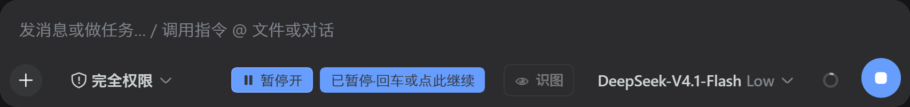

# DSH·暂停

## 引言

DeepSeek Harness 会自动调用工具并连续作答，虽然可以使用插话发送在中途提示，但是 DeepSeek 输出太快了，拼尽全力也没有其百分之一的 tok/s，根本无法成功插话。而直接打断 DeepSeek 的输出会导致其变成胆小菇，甚至不愿继续执行命令，工作积极性大幅下降。

为了能够成功在 DeepSeek 下一轮调用前插话并保护其弱小的心灵，此插件使用了拔网线的力量，假装卡了阻止 DeepSeek 发出下一次请求，直到你按下 Enter 或点按钮放行。暂停期间输入框照常可打字并插话发送后自动继续，或者直接回车让模型继续，这样在模型侧不会察觉到暂停的存在。

恰巧做完这个插件后，`deepseek-v4.1-flash-expires-on-0910` 速度已经到 300~400 tok/s，这下拼尽全力也追不上其百分之一的 tok/s，只能使用盘外招了。

注：现 deepseek-v4-flash 的速度约为 100 tok/s，而其一个中文字符约为 0.6 token，其百分之一的速度为 100 字/分钟，你的打字速度如何？

## 关键词

暂停 · 插话 · 无感

## 功能

**暂停点**：模型完成一轮工具交互、发出下一次请求前，插件让它停下来等你的位置。

- **可开关**：默认关闭，每个会话可独立开启。
- **仅在暂停点暂停**：只有这个位置会停，也就是模型完成一轮工具交互、正要发出下一次请求之前。你发消息触发的第一次请求不停，也不打断任何在途 API 调用。
- **保持 composer 可用**：暂停期间输入框照常可打字，不遮挡、不切换。
- **回车或按钮放行**：在主输入框按裸 Enter，或点「已暂停·回车或点此继续」按钮，都能放行暂停点。草稿为空无感放行，有字或图片则作为插话随本次请求一并发出。暂停点还没到时按回车也有效，消息立即以 steer 插话送出，不等下一个暂停点；这一轮已结束则由 steer 自己开新的一轮。
- **图片随插话**：按下回车时文字与图片一起立刻离开输入框，图片在后台序列化后随消息发出，不会只发文字而把图片留在输入框。发送失败时文字与已序列化的图片暂存到下次发送，序列化失败的图片需要重新选择。文件附件暂不支持插话，会被直接移出输入框并提示重新选择。
- **模型无感知**：上下文完整、不插入多余消息，模型察觉不到暂停存在。

## 它长什么样

开关打开、暂停被触发时，composer 工具行右侧出现一个暂停控件：



暂停时在主输入框按 Enter 即继续。未开启开关时不拦截任何按键，一切照常。

## 安装

**从 GitHub 安装**：源码在 `src/`，`lib/` 不入仓库，安装时 npm 会触发 `prepare` 脚本现场构建。

```powershell
dsh plugin --profile web add github:better-er/dsh-pause
```

**从 npm 安装**：包内已含构建产物 `lib/index.js` 与 `lib/client.js`，安装时不再构建。

```powershell
dsh plugin --profile web add dsh-pause
```

两种方式装完都会自动挂载，重启 DSH web 后启用，无需手工编辑任何文件。

## 卸载

```powershell
dsh plugin --profile web remove dsh-pause
```

彻底移除，重启 DSH web 后不再加载。

## 使用

1. 点 composer 工具行右侧的「暂停」按钮，变「暂停开」即该会话已开启。
2. 之后该会话的工具续跑请求会停在暂停点等你。
3. 需要放行时在主输入框按裸 Enter，空为无感继续，有字或有图为插话。也可点「已暂停·回车或点此继续」。暂停点还没到时按回车同样有效，消息立即 steer 送出；这一轮已经结束则由 steer 开新的一轮。
4. 用完再点「暂停开」关掉。暂停中关掉会放行当前暂停点。

## 配置

cordis 配置项 `defaultEnabled`，默认 false：

```yaml
plugins:
  dsh-pause:
    defaultEnabled: false
```

运行期可用 composer 里的开关逐会话切换，并覆盖 defaultEnabled。

## 工作原理

dsh 把一次模型请求当作一个 step，agent 连续调用工具时会经历 step、工具执行、下一次 step 的循环。本插件监听 `agent/pre-step`，由它决定何时出现暂停点。

- 暂停点设在请求真正发出之前，故无在途调用可打断。
- 续跑判定用同一 turn 内 step 大于 1 近似，每个 turn 的第一次请求永不暂停。
- 已有插话时不拦：本步已领取的批次带用户消息、插话还在 inbox 等认领、下一轮队列已有消息，任一条成立就跳过这次暂停点。
- 浏览器端经 `conversation.input.right` 槽位在 composer 工具行渲染控件。
- 带图插话由浏览器把草稿图片序列化成 base64 随放行请求上传，主机经 `attachments.admitPromptContent` 换成持久引用后与文字并入同一条 user 消息；RPC 请求体上限据此放宽到 300 MiB。
- 因 dsh 的 composer Enter 由 InputBar 私有 keymap 处理、第三方无 hook 点，开关开启期间用 DOM capture 常驻拦截裸 Enter，改走主机裁决，不改 DSH 源码。
- 有没有暂停点由主机权威判定：有就放行并把消息并入本步，没有就立即 `agent.steer`，空闲时 steer 自己开新 turn；插件不缓存插话，主机暂时发不出去时交回客户端暂存，不静默丢弃。
- 主机侧不经 `ctx.connection.rpc.handle`：该 API 自 0.1.2 起即不可用，改为向 webServer 自注册 `/dsh-pause` 前缀路由，复用 connection 的信任判定与浏览器鉴权，信封格式与官方一致。

## 开发

```powershell
pnpm install
pnpm typecheck
pnpm test
pnpm build
```

## License

[MIT](./LICENSE)

